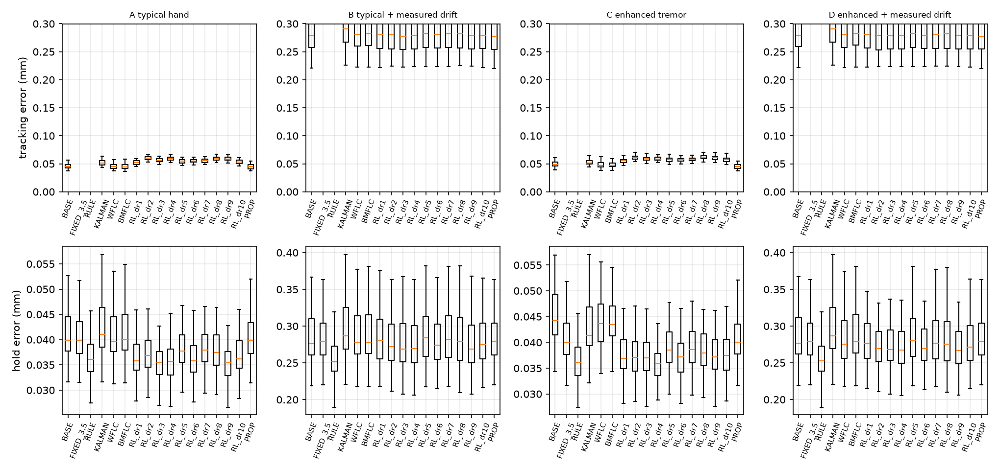
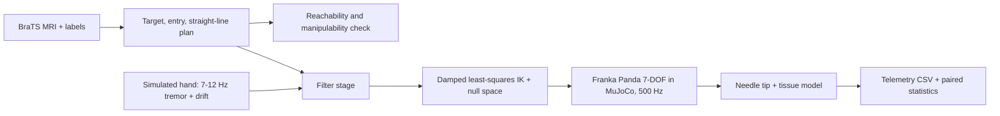
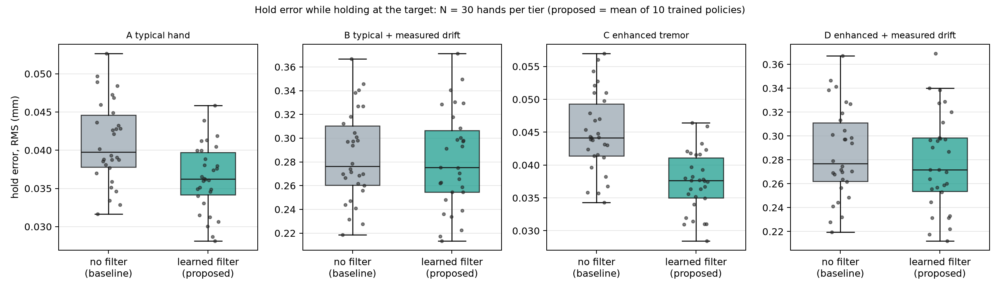
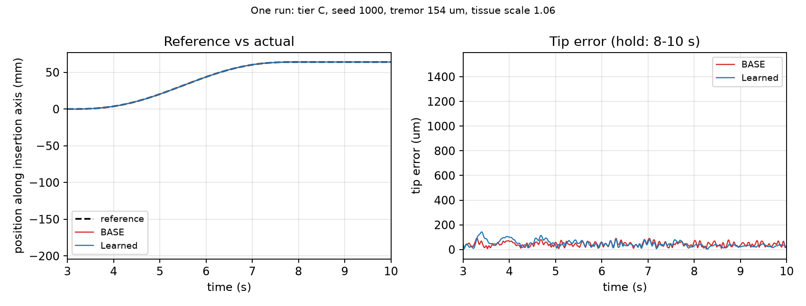
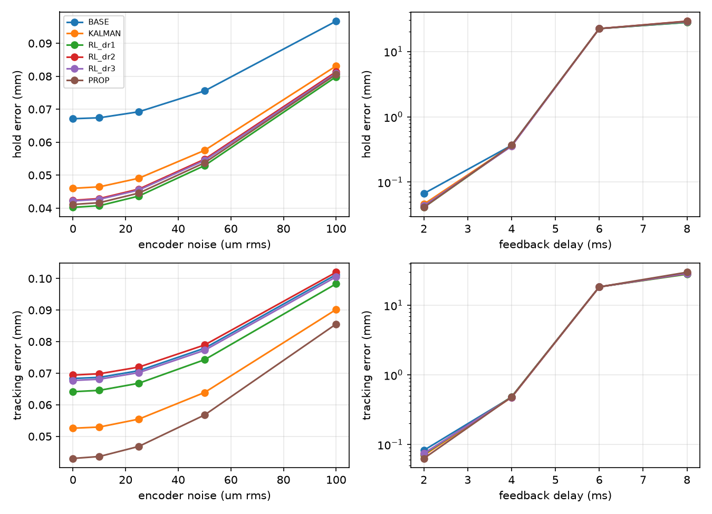

<div align="center">

# 7-DOF Surgical Robotic Assistant with Physiological Tremor Filtering

**Removing hand tremor from needle placement: control, learning, statistics and economics, in one reproducible MuJoCo study**

     

**MDRIIA Group 10** · Course 702CO0E012 · SVKM's NMIMS MPSTME, Mumbai · B.Tech CSBS
**Soumya Singh (E071)** · **Harshal Khandekar (E033)**

</div>

> **Simulation study. Not a clinical device.**



**Authorized research title**
> How can a 7-DOF surgical manipulator simulated in MuJoCo implement inverse kinematics Jacobian damping and low-pass tremor filtering to achieve sub-0.5 mm needle placement accuracy under simulated physiological surgeon hand tremor?

---

## Contents
[Highlights](#highlights) · [Why it matters](#why-it-matters) · [System](#system) · [Mathematics](#the-mathematics) · [Results](#results) · [Business case](#business-case-csbs) · [Engineering lessons](#engineering-lessons) · [Limitations](#limitations) · [Run it](#run-it) · [Repository map](#repository-map) · [References](#key-references)

---

## Highlights

| | |
| :--- | :--- |
| **Hold error, high-tremor tier C** | 45.0 → 37.4 µm (**−16.8%**), paired t = 13.78, p = 2.9×10⁻¹⁴, Cohen's d = 1.42, 95% CI of the improvement 6.4–8.7 µm |
| **Tremor rejection** | 14.3 dB (tuned unassisted baseline) → ~17 dB learned filter → **29.6 dB** plan-aware filter |
| **Plan-aware filter, tier C** | hold error −9.3%, tracking error −8.2% (better than baseline), 100% of runs under 0.5 mm |
| **Evidence** | 4 tremor tiers × 30 seeded hands, 10 independently trained learned policies (worst seed reported), paired statistics |
| **Pipeline** | real BraTS MRI → planned needle path → 7-DOF IK control → tremor filter → measured error, at 500 Hz |
| **Business case** | about 9 extra cases/yr of capacity at a 21-case hospital; break-even near **54 cases/yr** at USD 1.05 M capex |

Every number is generated by scripts in this repository from logged CSVs (hand seeds 1000–1029).

---

## Why it matters

- Stereotactic needles must land within about 1 mm. Published whole-system DBS radial error is **1.06 mm** (SD 0.55, n = 126; Giridharan et al., *Oper Neurosurg* 2022;23(3):254–260).
- A systematic review of 103 DBS publications reports intracranial complications in about **3.4–3.8%** of cases and lead revisions in **2.6–4.1%**, each revision being an additional intracranial procedure (PubMed 30071021).
- Physiological tremor peaks at **6–12 Hz**, with instrument-tip errors of 144–285 µm in surgeons (Wells et al., *IEEE SMC* 2013, pp. 1482–1487).
- Tremor is one measurable contributor to a larger error budget (about 4% of the whole-system error here; registration and brain shift dominate). We quantify and reduce our share of it.

---

## System



| Layer | What it does |
| :--- | :--- |
| **Physics** | MuJoCo 3.17, 1 ms timestep (implicitfast), control and logging at 500 Hz, Franka Panda with joint-position actuators and a 2 rad/s joint-speed limit |
| **Planning** | Targets and entries from real BraTS labels (enhancing, necrotic, oedema) across 6 scans and 19 case films; the safest path is the one with the highest minimum manipulability |
| **Control** | Resolved-rate IK with adaptive damped least squares, null-space posture control, PI position loop, needle-axis alignment, five-state machine (ALIGN → APPROACH → INSERT → HOLD → RETRACT, plus ABORT) |
| **Safety** | Singularity-aware damping and an abort below manipulability w = 0.015 |
| **Tremor model** | Three sinusoids at 7–12 Hz (weights 0.5 / 0.3 / 0.2) plus drift at 0.3–1.5 Hz; tiers A (24–50 µm, drift 40), B (24–50, 280), C (50–250, 40), D (50–250, 280) |
| **Filters** | Fixed 3.5 Hz low-pass, rule-based, Kalman, WFLC, BMFLC, a plan-aware low-pass, and a learned filter |
| **Learned filter** | PPO written in NumPy; a 2×64 tanh policy re-weights a bank of five Butterworth low-passes (1.5–14 Hz) plus the raw signal every 20 ms; domain-randomised training, 250 iterations × 16 hands × 600 decisions |
| **Tissue** | Axial spring-damper with stiffness scale 0.7–1.3 (an assumption, not a measurement) |

---

## The mathematics

**1. Damped least-squares IK with null-space posture control**

$$\Delta q = J^{T}\left(J J^{T} + \lambda^{2} I\right)^{-1}\Delta x \;+\; (I - J^{+}J)\,k_{ns}\,(q_{ref}-q), \qquad k_{ns}=2\ \mathrm{s^{-1}}$$

**2. Adaptive damping from Yoshikawa manipulability**

$$w=\sqrt{\det(JJ^{T})},\qquad \lambda=\lambda_0\left(1-\frac{w}{w_{th}}\right)\ \text{for } w<w_{th}=0.05,\quad \lambda_0=0.08$$

Otherwise λ = 10⁻³. The controller aborts if w < 0.015.

**3. PI position loop**

$$u = K_p\,e + K_i\!\int e\,dt,\qquad K_p=50,\quad K_i=0.003\,K_p^{2}=7.5$$

**4. Tremor model**

$$x_{tremor}(t)=\sum_{i=1}^{3} a_i \sin(2\pi f_i t+\varphi_i),\qquad f_i\in[7,12]\ \mathrm{Hz},\quad a_i\propto(0.5,\,0.3,\,0.2)$$

plus slow drift at 0.3–1.5 Hz.

**5. Tremor rejection**

$$R = 20\log_{10}\!\left(\frac{A_{in}}{A_{out}}\right)\ \mathrm{dB}$$

**6. Learned filter: a policy blends a Butterworth bank**

$$\hat{x}_t=\sum_{k=0}^{5}\mathrm{softmax}\big(\pi_\theta(o_t)\big)_k\; y^{(k)}_t,\qquad r_t=-\min(e_t^{2},e_{max}^{2})-0.02\,|\Delta W_t|$$

Here y⁽ᵏ⁾ are five order-2 Butterworth low-passes (1.5, 2.5, 4, 7, 14 Hz) plus the raw signal.

**7. Tissue model (assumption)**

$$F = k_s\cdot 15\,d + 3\,v$$

**8. Business case**

$$B = N\cdot NCRI + \Delta N\cdot m,\qquad P=\frac{T_{payback}}{T_{life}}$$

N = 21.33 cases/yr, NCRI = −0.1023, ΔN = 9.07 cases/yr, margin m = 0.5 (assumption), T_life = 7 yr. At 21 cases/yr, T_payback = 211.4 months and P = 2.52; P crosses 1 near 54 cases/yr.

---

## Results

Change versus the tuned unassisted baseline, high-tremor tier C:

| Filter | Hold error | Tracking while moving |
| :--- | :--- | :--- |
| Learned (10 policies) | −16.8% | 0.0494 → 0.0588 mm |
| Rule-based | −19.5% | 0.42 mm |
| Fixed 3.5 Hz low-pass | −9.4% | 0.83 mm |
| Plan-aware low-pass | −9.3% | 8.2% better than baseline |
| Kalman | −4.2% | 0.0526 mm |
| WFLC | −2.1% | n/a |
| BMFLC | −2.4% | n/a |

- **By tier**, the learned filter's hold-error change is A −11.3%, B −1.3%, C −16.8%, D −2.6%. The benefit concentrates where tremor is large and drift is small.
- **Trade-off:** the learned filter follows moving targets about 9–11 µm worse in tiers A and C. A tracking-aware retrain kept part of the gain (−8.7% hold) but missed our adoption rule, so it is reported as an ablation and not adopted.
- **Why not the rule-based or fixed filters:** they look good on hold error but lag heavily while moving (0.42 and 0.83 mm).
- **Sensor-delay sweep** (at the original Kp = 100): stable to 2 ms delay, error about 5× at 4 ms, unstable from 6 ms. Not re-run at Kp = 50.
- **Pass rate** (hold error under 0.5 mm) for the learned filter: 97% / 95% in the high-drift tiers B / D, against 100% for the baseline.





---

## Business case (CSBS)

Model: `analytics/surgical_or_economics.py`. Every input is tagged cited, derived or assumed (`docs/PARAMETER_PROVENANCE.md`).

- **Time:** 220 → 129 min per case (Owens 2026), about 9 extra cases per year of capacity at 21 cases/yr.
- **Capital:** USD 1.05 M (a vendor-blog midpoint, a weak source), maintenance factor 1.64, 7-year life (assumption).
- **Payback:** ratio 2.52 at 21 cases/yr, crossing 1 near 54 cases/yr at an assumed 0.5 margin per extra case. The target is high-volume neurosurgical centres or shared use.
- **Also modelled:** M/M/1 queueing, tornado sensitivity (±30%), and a seven-row FMEA with risk priority numbers before and after mitigation.

---

## Engineering lessons

- **Baseline tuning changed the conclusion.** Tuning the unassisted controller lifted its tremor rejection from 6.4 to 14.3 dB and shrank our headline gain from 38% to 9–17% depending on the filter. We report the tuned numbers.
- **The best filter on one metric was not the best overall.** Hold error and tracking pull in opposite directions; the plan-aware filter is the one that improves both.
- **Singularities needed an explicit guard,** not just damping (`src/singularity_test.py`).
- **Every claim is reproducible:** fixed seeds, logged CSVs, paired statistics, and a provenance file for each parameter.

---

## Limitations

- Simulation only. No MuJoCo contacts are active and tissue is a simple spring-damper.
- The target is treated as known; real registration error and brain shift are not modelled.
- Tumour scans provide realistic 3D geometry; the cost evidence comes from DBS literature.
- Improvements are measured against an unassisted robot, so they reflect the whole assistance package.
- The demo film's result card comes from our first experiment at the original controller gain; the tuned study above is the reference.

---

## Run it

```powershell
pip install mujoco numpy scipy matplotlib
python src/test_env.py            # physics smoke test
python src/launcher.py            # menu: live MuJoCo demo, films, site, figures
python src/section4_traj.py       # baseline vs learned trajectory, tier C
python analytics/surgical_or_economics.py
```

The launcher offers: live MuJoCo window, render and play, play an existing film, add a new MRI case, doctor-drives mode, the interactive website (business model, Tremor Lab, Case Gallery), and result figures. To open the site directly, open `docs/site/index.html`. BraTS data is not redistributed here; see `src/fetch_brats.py` and the BraTS licence.

---

## Repository map

```
src/         controller, scene build, RL training and evaluation, benchmarks, films, launcher
models/      MuJoCo MJCF (surgical_7dof_robot.xml, Franka Panda assets)
analytics/   trial CSVs, paired statistics, trained policies (rl_dr_s1..s10), economics model
docs/        technical dossier, parameter provenance, viva sheet, literature review
docs/site/   interactive model, Tremor Lab, Case Gallery
docs/figs/   result figures
```

---

## Team

| Roll | Name | Role |
| :--- | :--- | :--- |
| E071 | Soumya Singh | Lead surgical kinematics, damped least-squares IK, MuJoCo modelling |
| E033 | Harshal Khandekar | Digital signal processing, tremor modelling, Kalman filtering |

---

## Key references

- Riviere, Rader, Thakor. Adaptive cancelling of physiological tremor for improved precision in microsurgery. *IEEE TBME* 1998;45(7):839–846. doi:10.1109/10.686791
- Wells et al. *IEEE SMC* 2013, pp. 1482–1487.
- Giridharan et al. *Oper Neurosurg* 2022;23(3):254–260.
- Owens et al. 2026. doi:10.1159/000551466
- Childers, Maggard-Gibbons. Understanding costs of care in the operating room. *JAMA Surg* 2018. doi:10.1001/jamasurg.2017.6233
- Chiaverini. Singularity-robust task-priority redundancy resolution. *IEEE TRA* 1997. doi:10.1109/70.585902
- Full list: `docs/LITERATURE_REVIEW_AND_FOUNDATIONAL_PAPERS.md`

---

## AI assistance

Claude (Anthropic) assisted with code, analysis and documentation drafting. Results are reproducible from the scripts and logged CSVs. The AI audit log is in Section 5 of `docs/MDRIIA_Group_10_Technical_Dossier.docx`.

## Showcase

LinkedIn post: *add URL here*
